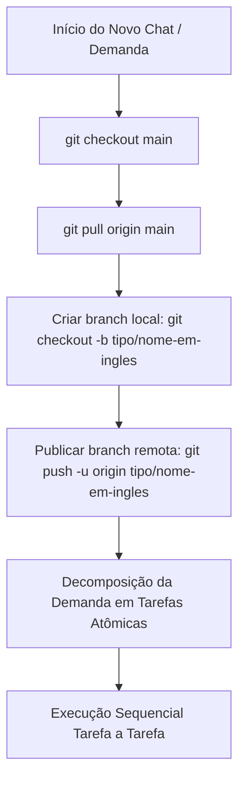

# Mnemosine — Diretrizes de Desenvolvimento e Fluxo Git 🏛️

> **Propósito do Documento**: Este arquivo estabelece o fluxo de trabalho obrigatório de engenharia de software para o desenvolvimento do **Mnemosine (O Palácio da Memória)** utilizando o **Google Antigravity em modo local**.  
> Todos os desenvolvedores e agentes de IA atuando neste repositório devem seguir rigorosamente os protocolos aqui descritos.

---

## 1. Filosofia de Desenvolvimento Local

O desenvolvimento do Mnemosine é conduzido no **modo local do Antigravity**, operando diretamente sobre o workspace de trabalho. Para garantir rastreabilidade, isolamento de mudanças e a capacidade de realizar **rollbacks precisos no tempo**, o fluxo é orientado a branches temáticas e commits atômicos incrementais.

---

## 2. Ciclo de Início de Novo Chat / Demanda

Ao iniciar qualquer nova sessão de trabalho ou receber uma nova funcionalidade/correção, o agente deve seguir obrigatoriamente esta sequência antes de escrever qualquer linha de código:



### Comandos de Inicialização:
```bash
# 1. Garante que a base local está idêntica à versão mais recente do remoto
git checkout main
git pull origin main

# 2. Cria a nova branch temática em inglês
git checkout -b <type>/<kebab-case-in-english>

# 3. Publica a branch imediatamente no GitHub
git push -u origin <type>/<kebab-case-in-english>
```

---

## 3. Convenções de Nomenclatura de Branches

O nome das branches deve sempre ser escrito em **inglês**, em formato **kebab-case** minúsculo, prefixado pelo tipo da demanda:

| Prefixo | Finalidade | Exemplo Válido | Exemplo Inválido |
| :--- | :--- | :--- | :--- |
| `feat/` | Nova funcionalidade ou módulo | `feat/sidebar-category-groups` | `feat/adiciona-sidebar` *(pt-BR)* |
| `fix/` | Correção de defeito funcional ou visual | `fix/modal-backdrop-scroll-leak` | `fix_modal_scroll` *(snake_case)* |
| `refactor/` | Reestruturação de código sem mudar comportamento | `refactor/project-card-state` | `refactor/ProjectCard` *(PascalCase)* |
| `style/` | Ajustes estéticos, alinhamento ou CSS puro | `style/greek-border-subtle-glow` | `style/ajusteCores` *(camelCase)* |
| `test/` | Adição ou reestruturação de testes | `test/icon-resolver-matrix` | `test/testes-icones` *(pt-BR)* |
| `docs/` | Atualizações de documentação e diretrizes | `docs/development-guidelines` | `documentacao/diretrizes` *(pt-BR)* |
| `chore/` | Tarefas de build, dependências ou configs | `chore/upgrade-playwright-noble` | `chore/update` *(muito vago)* |

---

## 4. Decomposição Obrigatória em Tarefas Atômicas

> [!IMPORTANT]
> **Proibição de "Mega-Diffs"**: Mesmo que o usuário forneça um prompt detalhado contendo múltiplas solicitações, alterações ou funcionalidades, **é terminantemente proibido executar tudo em um único bloco ou gerar um commit monolítico**.

### Protocolo de Execução Passo a Passo:
1. **Análise & Decomposição**: O agente divide o prompt em uma lista ordenada de tarefas atômicas e independentes.
2. **Apresentação do Checklist**: O agente expõe o checklist no chat para acompanhamento visual do usuário.
3. **Execução Sequencial**: O agente executa uma tarefa por vez:
   - Altera/adiciona os arquivos pertinentes àquela tarefa.
   - Executa a validação incremental (`pnpm tsc --noEmit` e testes unitários relevantes).
   - Realiza o commit atômico seguindo a convenção.
   - Faz o `git push` para a branch remota.
   - Marca a tarefa como concluída no checklist e avança para a próxima.

### Por que esse padrão é obrigatório?
- **Rollback cirúrgico**: Se uma alteração posterior causar um bug ou efeito colateral indesejado, é possível usar `git revert <hash>` ou `git checkout <hash>` sem perder as outras partes implementadas.
- **Auditoria transparente**: Facilidade de revisar no GitHub cada etapa lógica individualmente.
- **Depuração simplificada**: O histórico de commits documenta exatamente o racional de cada arquivo modificado.

---

## 5. Padrão de Conventional Commits

Todos os commits devem seguir estritamente o padrão **Conventional Commits em inglês**:

### 5.1 Anatomia do Commit
```text
<type>(<scope>): <short imperative description in english>
```
- `<scope>` é **recomendado** quando a alteração incide sobre um componente ou módulo específico (ex: `feat(sidebar): ...`, `fix(modal): ...`), e opcional para alterações gerais de sistema.
- A descrição deve utilizar o **verbo no imperativo presente** (ex: `add`, `fix`, `refactor`, `prevent`, `update`), nunca no passado (`added`, `fixed`).
- Primeira letra minúscula após o `:` e **sem ponto final** no término da mensagem.

### 5.2 Tipos Permitidos e Exemplos:
```bash
# Features
git commit -m "feat(sidebar): add collapsible category groups with active border"

# Correções de bugs
git commit -m "fix(modal): prevent body scroll lock leak when closing on escape"

# Refatorações
git commit -m "refactor(projects): extract folder state logic to custom hook"

# Estilo e CSS
git commit -m "style(cards): adjust hover radial gradient to subtle gold glow"

# Testes
git commit -m "test(integration): add test cases for project creation flow"

# Documentação
git commit -m "docs(testing): update visual regression guidelines and docker commands"

# Manutenção / Dependências
git commit -m "chore(deps): bump motion to latest patch version"
```

---

## 6. Validação Incremental Pré-Commit

Antes de consolidar cada commit atômico na branch, execute a validação rápida:

```bash
# 1. Verifica se a tipagem TypeScript continua 100% íntegra
pnpm tsc --noEmit

# 2. Executa os testes unitários relevantes ao módulo alterado
pnpm test
```

Ao concluir a última tarefa da branch, execute a validação abrangente:
```bash
# 3. Execução completa da suíte de testes e validação de build de produção
pnpm test && pnpm build
```

---

## 7. Conclusão e Entrega da Branch

Quando todas as tarefas atômicas do checklist forem concluídas e enviadas para o remote:
1. O agente apresenta o resumo das tarefas finalizadas e a lista de commits gerados.
2. O agente oferece ao usuário as opções de encerramento:
   - **Opção A (Recomendada)**: Criar um Pull Request via GitHub MCP (`create_pull_request`) com descrição sumarizada para revisão e merge.
   - **Opção B**: Realizar o merge assistido localmente para a `main` e push final:
     ```bash
     git checkout main
     git pull origin main
     git merge <branch-name>
     git push origin main
     ```
